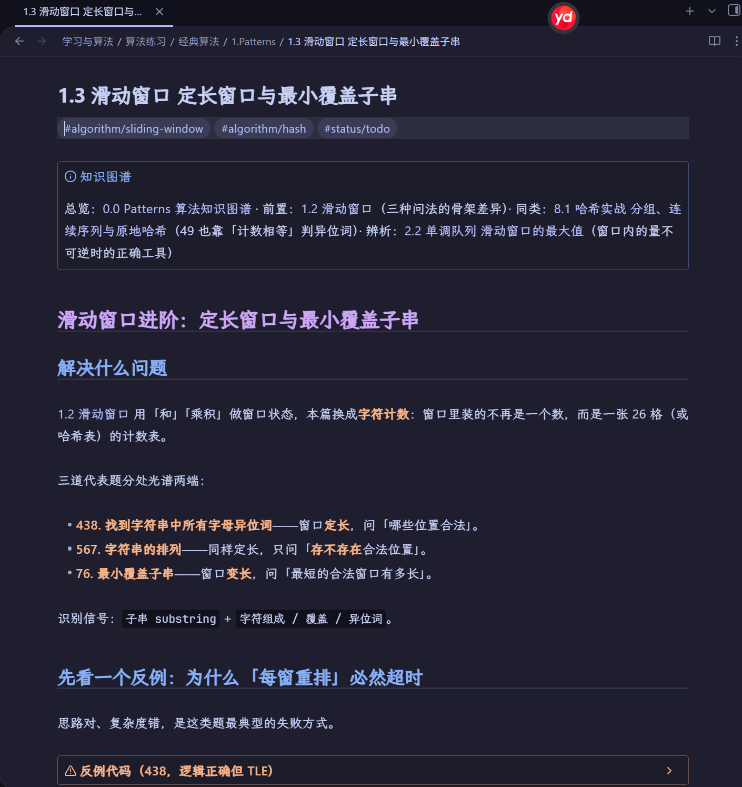
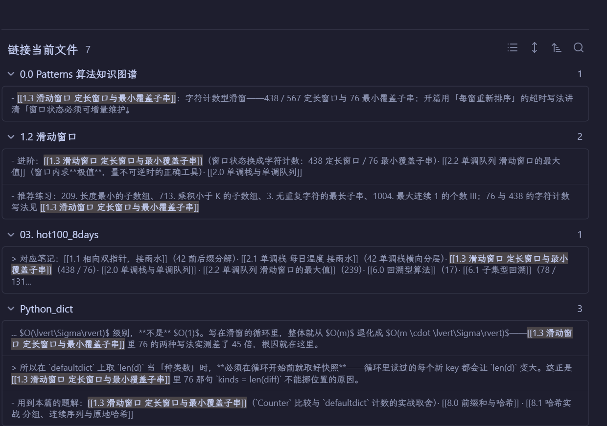
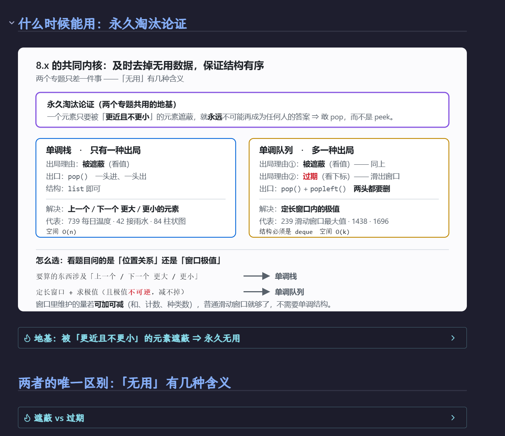
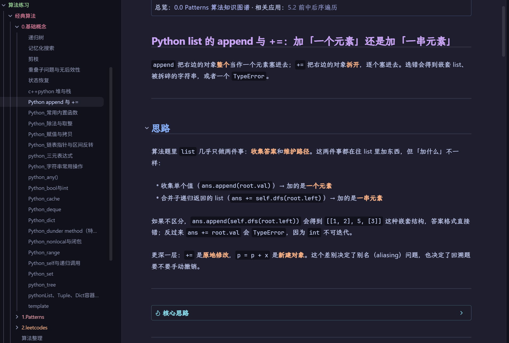
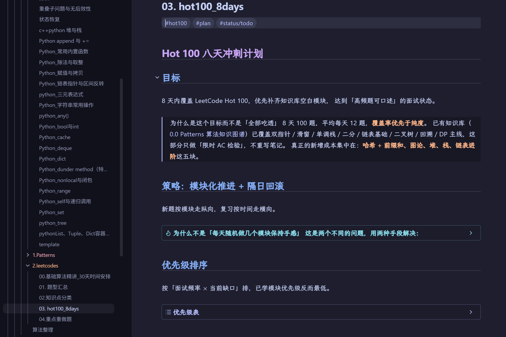

# Algorithm Notes for Job

跟着 [灵茶山艾府](https://space.bilibili.com/206214) 老师的 [【基础算法精讲】](https://space.bilibili.com/206214/channel/collectiondetail?sid=842776) 系列整理的算法笔记，面向求职面试复习。

笔记按「专题模板 → 典型变体 → 易错点 → 复杂度」组织，代码以 Python 为主。推荐配合视频或题单一题一题地刷，而不是只看笔记。

**51 篇专题笔记 · 22 篇原始推导稿 · 25 篇小白向基础概念 · 57 张原理图 · 330+ 道题目直链**

- **零基础也能看**：除了算法本身，还补了 Python 语法、数据结构和递归思维这些「默认你会」的前置知识。
- **题库跟着灵神走**：题目顺序、课后作业都按灵茶山艾府老师的课程和题单来，每道题都有力扣链接，点开就能直接刷。
- **在 Obsidian 里成网**：笔记之间用双链互相引用，复习时可以顺着知识点往回查。

> [!NOTE]
> 本仓库的课程思路、题目选择和讲解顺序均来自原作者 **@灵茶山艾府**，这里只是个人学习时的整理与补充。如有理解错误，欢迎提 Issue / PR 指正。

## 笔记预览

### 每篇笔记长什么样

开头的「知识图谱」卡片标出前置、同类和易混专题；正文先讲这类题解决什么问题，再用一个反例说明常见写法为什么会超时。



### 双链：知识点之间互相串起来

在 Obsidian 的反向链接面板里，可以看到哪些笔记引用了当前这篇：专题入口、前置专题、刷题计划和 Python 基础概念都会出现，复习时可以顺着链条往回查。



### 原理图：把「为什么」画出来

难懂的推导都配了 SVG 示意图，例如单调栈和单调队列的共同内核：



<table>
  <tr>
    <td width="50%"><br><sub>4.1 快慢指针：环入口推导</sub></td>
    <td width="50%"><br><sub>7.5 状态机 DP：股票买卖转移图</sub></td>
  </tr>
</table>

全部示意图在 [`1.Patterns/assets/`](1.Patterns/assets) 里。

### 面向小白：必要的基础知识都补上了

`0.基础概念/` 收录了刷题时常被一笔带过、但新手很容易卡住的知识：`append` 和 `+=` 的区别、整除与取整、赋值与拷贝、`deque` / `dict` / `set` 的用法、闭包与 `nonlocal`，以及递归树、记忆化搜索、剪枝、状态恢复等通用思想。大部分笔记都会标出它在哪些算法专题里用到。



### 题库：跟着灵神刷，点开链接就能做

`2.leetcodes/` 里的题单默认按灵茶山艾府老师的课程编排：

- [`01. 题型汇总.md`](2.leetcodes/01.%20题型汇总.md)：每一讲对应的 **B 站视频、力扣题目、灵神题解代码** 三个链接放在同一行，带 `*` 的是课后作业。
- [`00.基础算法精讲_30天时间安排.md`](2.leetcodes/00.基础算法精讲_30天时间安排.md)：把课程拆成 30 天，每天该刷哪几题都排好了。
- [`02.知识点分类.md`](2.leetcodes/02.知识点分类.md)：按知识点重新归类，末尾附灵神的完整分类题单（滑动窗口、二分、单调栈、DP、图论……），适合学完课程后继续进阶。
- [`03. hot100_8days.md`](2.leetcodes/03.%20hot100_8days.md)：面试前 8 天过完 LeetCode Hot 100 的冲刺计划，每天的任务都附上对应的专题笔记。



## 目录结构

```text
.
├── 0.基础概念/        面向小白的前置知识：Python 语法与数据结构（deque、dict、set、闭包、拷贝、整除……）
│                      以及递归树、记忆化搜索、剪枝、状态恢复等通用概念
├── 1.Patterns/        核心：按算法专题整理的模板笔记（1.0 ~ 15.0）
│   ├── 0.0 Patterns 算法知识图谱.md   ← 总入口，从这里开始
│   ├── assets/        专题笔记里的 SVG 示意图
│   └── 原始稿件/      视频跟学时的原始推导、截图和练习记录（x.x.1 编号）
├── 2.leetcodes/       刷题计划与题单（跟随灵神题库，题目均为力扣直链）
│   ├── 00.基础算法精讲_30天时间安排.md   按天排好的跟课计划
│   ├── 01. 题型汇总.md                   视频 + 题目 + 题解，一讲一行
│   ├── 02.知识点分类.md                  按知识点归类 + 灵神完整题单
│   ├── 03. hot100_8days.md               Hot 100 八天冲刺
│   └── 04.重点重做题.md
├── attachments/       原始稿件中的截图（由同步脚本自动收集）
├── 算法整理.md         整理笔记时给 AI 用的提示词，可参考来整理自己的笔记
├── docs/images/       README 用的截图
└── scripts/           从个人 Obsidian 库同步到本仓库的脚本
```

### 1.Patterns 专题一览

| 编号 | 专题 | 编号 | 专题 |
|---|---|---|---|
| 1.x | 相向双指针、滑动窗口 | 8.x | 前缀和、哈希、差分 |
| 2.x | 栈、单调栈、单调队列 | 9.x | 图论：DFS/BFS、拓扑排序、并查集、最短路 |
| 3.x | 二分查找（红蓝染色法）、二分答案 | 10.0 | 堆：TopK 与对顶堆 |
| 4.x | 链表：反转、快慢指针、LRU、归并 | 11.x | 区间问题、贪心 |
| 5.x | 递归与二叉树 | 12.0 | 数组与矩阵的原地操作 |
| 6.x | 回溯：子集型、组合型、排列型 | 13.0 | 排序：快排、归并、堆排 |
| 7.x | 动态规划：背包、线性、状态机、区间、树型 DP | 14.0 / 15.0 | 位运算 / 字符串（KMP、回文） |

主目录里的 `x.0` 是专题入口（统一模板 + 选型判据），`x.1`、`x.2`… 是该专题下的变体；`原始稿件/` 里对应的 `x.x.1` 是第一次跟视频时的原始记录，适合想看推导过程时对照。

## 如何使用

### 推荐：用 Obsidian 打开（体验最好）

笔记大量使用了 Obsidian 的 `[[双链]]`、Callout（`> [!tip]`）、标签和 LaTeX 公式，在 Obsidian 里可以直接点击跳转、查看关系图谱。

1. 下载本仓库：点右上角 **Code → Download ZIP** 后解压，或者

   ```bash
   git clone https://github.com/lionleepower/Algorithm_Notes_forJob.git
   ```

2. 安装 [Obsidian](https://obsidian.md/)（免费），选择 **打开本地仓库 / Open folder as vault**，选中解压后的文件夹。
3. 打开 `1.Patterns/0.0 Patterns 算法知识图谱.md`，从这里按专题顺序往下读。
4. 想按天跟课，就看 `2.leetcodes/00.基础算法精讲_30天时间安排.md`。

小技巧：

- **关系图谱**（左侧栏 Graph view）可以看到专题之间的关联。
- 按标签检索：搜索 `tag:#status/review`、`tag:#algorithm/binary-search` 等。
- 不需要安装任何第三方插件。

### 直接在 GitHub 上看

也可以在线浏览，图片和公式能正常显示；但 `[[双链]]` 和部分 Callout 在 GitHub 上会显示为普通文本，需要手动按文件名找到对应笔记。

## 学习建议

1. 先看视频，自己动手写一遍，再对照笔记里的模板和易错点。
2. 每个专题先读 `x.0` 入口，弄清楚「什么不变、什么在变」，再做变体题。
3. 隔几天回来只看每篇笔记的核心结论，能口述出思路和复杂度就算过关；卡住的题记到 `04.重点重做题.md`。

## 致谢

- 原作者：[@灵茶山艾府](https://space.bilibili.com/206214)
- 课程：[【基础算法精讲】](https://space.bilibili.com/206214/channel/collectiondetail?sid=842776)
- 题目来源：[力扣 LeetCode](https://leetcode.cn/)

## 许可协议

本仓库笔记采用 [CC BY-NC-SA 4.0](https://creativecommons.org/licenses/by-nc-sa/4.0/deed.zh-hans) 协议：可以自由转载和改编，但需署名、不得用于商业用途，改编后的作品须以相同协议发布。课程本身的版权归原作者所有。
